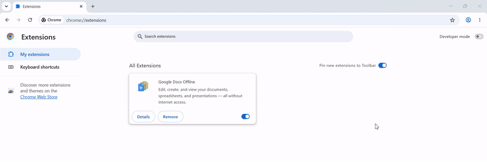

# see-the-arrow

**Teach me, don't do it for me.**

Your AI agent points at the screen one step at a time. You do the clicking, and you learn the app.


<sub>Blender, taught by an agent that only sees screenshots: it points, the human clicks, it looks
again. The waits while the agent read each screenshot are cut. <a href="#how-the-agent-teaches">The commands</a>.</sub>

see-the-arrow draws a big arrow with a sign on top of any window, on Windows and Linux. An AI agent
(Claude Code, Codex, ...) uses it to show you where to click instead of clicking for you, so next
time you know the way. It finds a button by its name where the app tells the system what its
buttons are called, and by its pixels where the app does not: Blender draws its own interface, and
the agent still finds Add, Mesh and Monkey in a screenshot.

Clicks go through the arrow, the keyboard stays where it was, and every arrow ends by itself. It
never clicks and never types. It reads the screen only when the agent runs `bigarrow screenshot`,
into the file the agent names.

## Try it

Ask your agent (Claude Code, Codex, ...):

```text
Install see-the-arrow on this machine.
Follow https://raw.githubusercontent.com/chocodev11/see-the-arrow/main/docs/INSTALL.md
```

It downloads `bigarrow`, installs the agent skill and shows a first arrow. Then ask:

```text
Teach me to add a monkey head in Blender. Point at each step on my screen and let me click.
```

## How the agent teaches

Blender draws its own interface, so UI Automation sees its title bar and nothing else. The agent
looks instead: it takes a screenshot, finds the next item in the image, points at it and waits for
your click.

```powershell
bigarrow screenshot --window blender --png step.png --max-size 1280 --json
# {"ok":true,"path":"D:\\work\\step.png","rect":[0,0,1920,1020],"size":[1280,680]}
# Add sits at image pixels 212-236, 43-59; one image pixel is 1920 / 1280 = 1.5 screen pixels
bigarrow point --app blender --no-raise --rect 318,64,36,25 --until-click --size S --color green --from bottom --text "1. Click Add"
bigarrow screenshot --window blender --no-raise --png step.png --max-size 1280 --json   # the Add menu is open now
bigarrow point --app blender --no-raise --rect 318,95,204,22 --until-click --size S --color blue --from right --text "2. Then Mesh"
bigarrow screenshot --window blender --no-raise --png step.png --max-size 1280 --json   # and the Mesh submenu
bigarrow point --app blender --no-raise --rect 528,327,201,22 --until-click --size S --color orange --from right --text "3. Then Monkey"
```

`--until-click` returns once you click the target, so the agent knows when to look again. Image
pixel (x, y) is the screen pixel (rect x + x * rect width / image width, rect y + y * rect height /
image height). `--max-size 1280` keeps the image small enough for a vision model to read at full
size; models shrink larger images on their own, which shifts every coordinate read from them. The
capture shows what you see, arrows included: `bigarrow stop` first for a clean one, or keep them to
check where they landed.

### A map of the app


<sub>Blender 5.0's first screen, explained in five arrows. Every tip on the signs is true.</sub>

```powershell
bigarrow start --app blender --size S --rect 318,64,36,25 --color green --from bottom --text "Shift+A adds objects"
bigarrow start --app blender --size S --rect 1470,135,90,90 --style ring --color purple --from left --text "Drag to orbit"
bigarrow start --app blender --size S --rect 1583,587,30,30 --color orange --shape zigzag --from left --text "Modifiers live here"
bigarrow start --app blender --size S --rect 735,928,25,25 --color red --from top --text "Space plays it"
bigarrow start --app blender --size S --rect 716,408,156,176 --style ring --color blue --from top-right --text "Tab: edit its vertices"
```

## Apps with labels

Most apps tell the system what their controls are called: UI Automation on Windows (Control Panel,
Chrome and the web pages in it), AT-SPI on Linux. There the agent points by name with `--element`,
no screenshot needed. `bigarrow elements` lists the names an app gives.

![The Windows 11 Control Panel over the default wallpaper, with seven arrows pointing in from the free space around the window: a black sign "Still here in 2026" at the window corner, a red "Firewall: still in here" with a close button on System and Security, a purple zigzag "Device Manager is in here" on Hardware and Sound, a green box "Same list as appwiz.cpl" on Uninstall a program, an orange zigzag "UTF-8 lives in Region" on Clock and Region, a pink ring "Large icons: one page" on the View by menu, and a teal spiral "Or just type it" on the search box](docs/images/control-panel.png)

<sub>The Windows 11 Control Panel, seven `bigarrow start` commands. Every tip on the signs is true.</sub>

```powershell
$cp = "Windows Explorer:Control Panel"   # Control Panel runs inside explorer.exe
bigarrow start --window $cp --anchor top-left --size S --color black --border white-black --from top-left --text "Still here in 2026"
bigarrow start --app $cp --element "System and Security" --role link --size S --color red --close-button --from left --text "Firewall: still in here"
bigarrow start --app $cp --element "Hardware and Sound" --role link --size S --color purple --shape zigzag --from left --text "Device Manager is in here"
bigarrow start --app $cp --element "Uninstall a program" --role link --size S --style box --color green --from bottom-left --text "Same list as appwiz.cpl"
bigarrow start --app $cp --element "Clock and Region" --role link --size S --color orange --shape zigzag --from right --text "UTF-8 lives in Region"
bigarrow start --app $cp --element "Category" --style ring --size S --color pink --from top-right --text "Large icons: one page"
bigarrow start --app $cp --element "Search Box" --role textfield --size S --color teal --shape spiral --from right --text "Or just type it"
bigarrow stop --all                      # when done
```

## When the agent needs your hand

Some steps stay yours even when the agent could find them: a permission, a setting that needs an
administrator, a payment, a code from your phone. The agent points and waits.



```powershell
bigarrow point --app "Google Chrome" --element "Developer mode" --until-click `
  --color blue --from bottom-left --text "Turn on Developer mode"
```

| Situation | Why it needs you | What the agent runs |
|---|---|---|
| Learning an app | You learn by doing it, not by watching it done | one `point --until-click` per step, a new `screenshot` in between |
| A setting that needs an administrator | The agent runs without elevation, and should | `--app "Windows Explorer:Control Panel" --element "Clock and Region"` |
| Permission and consent prompts | Saying yes is your decision | `--element Allow --until-click` |
| Loading what the agent just built | Chrome keeps Developer mode a manual switch | `--element "Developer mode"`, then `--element "Load unpacked"` |
| Codes, PINs, tokens | You have them, or must see them | `--text "Paste {{FKX7-29QD}} into the code field"`: `{{...}}` becomes a copy button |
| You are not looking | Nobody reads a terminal from across the room | `--say` reads the sign aloud |

## Many arrows at once

`bigarrow start` returns at once and leaves the arrow up, so steps can be shown together. Signs keep
off the other arrows' signs and targets, and a sign that sits where a newer arrow points steps
aside by itself. Crossing shafts are avoided where there is room. A window with free desktop
around it gives the signs the most room; a maximized one leaves them nowhere to go but over it.

## How it works

- **Click-through by shape.** Only the sign and the shaft take clicks. On Windows an invisible hit
  window shaped exactly like them sits above the click-through drawing; on X11 the window's input
  shape does the same. The target under the arrowhead stays clickable.
- **Never takes the focus.** The overlay windows cannot be activated. Bringing the target's window
  to the front is the only focus change (`--no-raise` skips it), and no key or click is ever
  synthesized.
- **Event-driven.** `--follow`, hiding while another app covers the target and making room for
  newer arrows all react to window events (WinEvents, X11 notifications), not to a polling timer.
- **Real pixels.** Coordinates in and out are the pixels that UI Automation, AT-SPI and
  full-resolution screenshots report, on every display and DPI.
- **One look everywhere.** Nunito Black and JetBrains Mono are built in, so a sign looks the same on
  every system and renders accents such as Vietnamese correctly.
- **Light.** One small process per arrow; the pulse replays prerendered frames.
- **Leaves nothing behind.** A live arrow holds a file lock; when its process dies, the lock and
  the arrow go with it.

## Install

The prompt in [Try it](#try-it) has your agent download `bigarrow` for Windows (x64) or Linux
(x86-64, glibc 2.35 or newer) from the
[latest release](https://github.com/chocodev11/see-the-arrow/releases/latest), install the agent
skill and show a first arrow. By hand: unpack that archive, put `bigarrow` on your `PATH`, then
run `bigarrow install-skill`. From source, with Rust 1.89 or newer (on Windows Rust also needs the
Visual Studio Build Tools):

```powershell
cargo install see-the-arrow --locked
bigarrow install-skill                 # Claude Code (~/.claude/skills) and Codex (~/.agents/skills)
```

Windows 10 or 11 needs nothing else. Linux needs an X11 session; a compositing window manager gives
the drop shadow and smooth edges, and `--say` uses `spd-say` or `espeak-ng`.

## Commands

| Command | What it does |
|---|---|
| `point` | Draws an arrow and waits until it ends (8 s by default) |
| `start` | The same in the background, until `bigarrow stop` (300 s at most by default) |
| `clear`, alias `stop` | Removes the newest arrow; `--all`, `--pid`, `--session`, `--hook` |
| `front` | Brings an app, a window or a browser tab to the front |
| `elements` | Lists what `--element` can point at in an app |
| `screenshot` | Saves a display, a window or a rect to a PNG, in the pixels `--at` uses |
| `doctor` | Shows displays, UI Automation or AT-SPI, and elevation |
| `demo` | An arrow, a ring and a box in turn |
| `install-skill` | Installs the agent skill |

- **Targets:** `--at X,Y`, `--rect X,Y,W,H`, `--mouse`, `--window App[:title]` with `--anchor`,
  `--element Label --app App[:title]` with `--role`. `--display N` makes `--at` and `--rect`
  relative to display N.
- **Looks:** `--color` (red, orange, yellow, green, teal, blue, purple, pink, black, white or
  `#RRGGBB`), `--size S|M|L`, `--style arrow|ring|box`, `--shape bend|straight|zigzag|spiral`,
  `--border shadow|white-black|black`, `--corners round|sharp`, `--from`, and colours for the
  border, text, edge and close button.
- **Behaviour:** `--duration`, `--close-button`, `--until-click`, `--until-any-click`, `--follow`,
  `--say`, `--voice`, `--json`, `--dry-run`, `--png`.

Every arrow ends by itself: after its duration, on `bigarrow stop`, when the agent that drew it exits
(`CLAUDE_PID` or `BIGARROW_OWNER_PID`), or when the human answers (`bigarrow stop --hook` as a Claude
Code `UserPromptSubmit` hook).

Exit codes: 0 ok, 2 bad input, 3 target not found, 4 permission missing.

## FAQ

**Does it click or type for me?** No. Pressing the button stays the human's job; that is the point.

**What does the agent see, and where do screenshots go?** Nothing until it runs
`bigarrow screenshot`, which writes a PNG on your machine and sends it nowhere. The agent then
reads that file, so the image goes to your model provider, just as if you had pasted it into the
chat yourself. `--window App` captures only the area of that window, after bringing it to the
front; the skill tells agents to capture only the app they are teaching, and nothing while a
password manager, a bank or private messages are open.

**Will it steal my keyboard while I type?** No. The arrow's windows can never be activated. Only
bringing the target window forward changes the focus, and `--no-raise` turns that off.

**Can I click through it?** Everywhere except the sign and the shaft. The target under the
arrowhead takes clicks as usual. A click on the sign closes the arrow; a click on a copy button
copies its value.

**Why `--app "Windows Explorer:Control Panel"`?** On Windows some windows belong to another
program: Control Panel runs inside `explorer.exe`. The part after the colon picks the window by its
title. `bigarrow elements` shows the names to use. A placeholder is not a name: Control Panel's
search field is `Search Box`, not "Search Control Panel".

**Does `--element` see inside web pages?** In Chrome, yes: web content, `chrome://` pages and DevTools
all reach UI Automation without a flag.

**Can it draw over a UAC prompt or the lock screen?** No. Those run on a secure desktop that no
other program can draw on. See [Limits](#limits).

**Why is the command called `bigarrow`?** see-the-arrow keeps the command line of
[bigarrow for macOS](https://github.com/franzenzenhofer/big-arrow-on-the-screen), so agent skills
and scripts written for it run here too.

## Compatibility with bigarrow for macOS

Same subcommands, flags, defaults, messages, exit codes and JSON. Where the systems differ,
see-the-arrow follows Windows and Linux:

| | bigarrow for macOS | see-the-arrow |
|---|---|---|
| Coordinates | logical points | physical pixels (Windows), root window pixels (X11) |
| `--peekaboo`, `--snapshot` | Peekaboo snapshots | not available: Peekaboo is a macOS tool |
| `screenshot` | not there (Peekaboo takes screenshots) | saves a display, window or rect to a PNG in the pixels `--at` uses |
| The target's app does not come to the front | exit 3 | Windows refuses to hand over the focus at times: `point` and `start` warn, flash the taskbar button and show the arrow once the window is visible; `front` still exits 3 |
| `doctor --json` | TCC permissions, `macOS` | `os`, plus `elevated` and `uiAutomation` (Windows) or `session`, `compositor`, `atspi` (Linux) |
| `elements --json` | `frame: [[x,y],[w,h]]`, AX fields | `frame: [x,y,w,h]`, `role`, `name`, `value`, `id`, `enabled` |
| Exit 4 | missing Accessibility or Screen Recording | the target runs as administrator, or `screenshot` on a locked screen (Windows); no accessibility bus, a Wayland session, or `screenshot` through XWayland (Linux) |
| `--say` | `say` | SAPI voices, OneCore ones included (Windows); `spd-say` or `espeak-ng` (Linux) |
| `--role` | AX roles | both naming schemes: `button`, `radiobutton`, `textfield`, ... and `Edit`, `TabItem`, `push button`, ... |

## Limits

- **Windows:** the Start menu, Alt-Tab, the lock screen, UAC prompts and exclusive full-screen games
  stay above every other window, the arrow included. An arrow lives on the virtual desktop it
  started on. A `clear` without administrator rights cannot end an arrow started as administrator.
- **Linux:** Wayland sessions draw through XWayland, but `--mouse`, `--window`, `--element`,
  `--until-click`, `screenshot` and hiding while covered need X11 and exit 4 there. XWayland never
  lets apps read the screen, WSLg included. Without a compositor there is
  no shadow, edges are hard and a screenshot may leave the arrows out. On X11 a copied value lives as long as the arrow unless a clipboard
  manager takes it.
- Colour emoji are drawn in one colour or not at all.

## How we know it works

- **Measured on Windows 11 25H2 at 125 % scaling:** `start` returns in 113 to 239 ms, `stop` in
  about 240 ms including the 0.2 s fade. A pulsing arrow costs 0.5 to 0.8 % of one CPU core and
  about 20 to 24 MB of memory.
- **Tested:** unit tests for geometry, placement and rendering; command-line contract tests that
  run the built binary; and screen tests that draw real arrows and check focus, click-through,
  clean-up and that a screenshot shows each arrow exactly where its JSON says
  (`BIGARROW_SCREEN_TESTS=1`). The Linux build is checked under X11 (Xvfb in CI).
- **Real captures:** the pictures and animations above are screen captures of Windows 11 with the
  arrows on screen, not mock-ups. The Blender picture is `bigarrow screenshot`'s own output.

## Development

```powershell
cargo clippy --all-targets -- -D warnings
cargo build --release
cargo test                                  # never draws on the screen
$env:BIGARROW_SCREEN_TESTS = 1; cargo test  # draws real arrows and reads the screen
bigarrow point --at 760,500 --text "Click here" --png arrow.png   # look without drawing
```

[AGENTS.md](AGENTS.md) holds the rules of the code base.

## Credits and license

MIT, see [LICENSE](LICENSE). The idea, the command line, the look and the agent skill come from
[bigarrow for macOS](https://github.com/franzenzenhofer/big-arrow-on-the-screen) by Franz
Enzenhofer (MIT). Icons from Feather, fonts Nunito and JetBrains Mono (OFL); see
[THIRD_PARTY_NOTICES.md](THIRD_PARTY_NOTICES.md).
